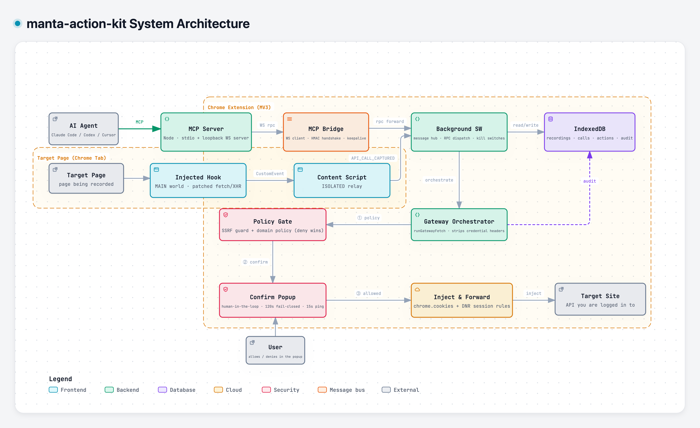

<div align="center">

# Manta Action Kit

**Give your AI agents secure access to your real, logged-in APIs — without ever handing over your credentials.**

[](https://chromewebstore.google.com/detail/manta-action-kit/pghddhbhbnlcehlmgnnalgaephllkeel)
[](LICENSE)
[](https://modelcontextprotocol.io)
[](PRIVACY.md)

**English** | [中文](README.zh-CN.md)

</div>

Claude Code, Codex, Cursor — they write great code, but they can't safely touch
your **authenticated** business APIs. Either you paste cookies and tokens into
agent configs (leaking credentials into transcripts and logs), or you tell the
agent "sorry, you can't do that."

**Manta Action Kit** fixes this. Record a real API flow once in your browser,
then let your agent replay it or call those endpoints freely — while your
cookies and tokens stay locked inside your browser. The agent never sees a
single credential.

## How it works



1. **Record** — click _Start_ in the popup, use the site normally, click _Stop_.
   The extension captures every `fetch`/`XHR` (requests **and** responses,
   including SSE streams) into a local, inspectable call chain.
2. **Distill** — your agent reads the recording through MCP and distills it
   into a reusable, parameterized **Action** (`{{param}}` templates,
   step-to-step output passing).
3. **Execute** — `execute_action` or `proxy_fetch` re-fires the flow through a
   sandbox gateway. The extension injects your session cookies at forward time;
   the AI only ever sent `method/url/headers/body`.

## Quick start

**1. Install the extension** from the
[Chrome Web Store](https://chromewebstore.google.com/detail/manta-action-kit/pghddhbhbnlcehlmgnnalgaephllkeel),
then log into the site you want the agent to call — you'll record from it in
step 5.

**2. Copy the install prompt** — click the extension's toolbar icon and open
its side panel (via the popup's _Open side panel_ entry) → _Action_ tab →
_Copy install prompt_. It embeds your personal bridge token (`MANTA_TOKEN`).
Can't see the toolbar icon? Chrome tucks new extensions behind the
puzzle-piece menu next to the address bar — open it and pin Manta Action Kit.

**3. Add the MCP server to your agent.** MCP is the standard way AI agents
plug in external tools — you don't need to understand it, just follow along.
You'll need [Node.js](https://nodejs.org) ≥ 18 (check with `node -v`; if it's
missing, grab the LTS installer from nodejs.org). The prompt is
client-agnostic — paste it into Claude Code, Codex, or any MCP client and the
agent registers the server into its own config, or add this to your MCP
config by hand:

```json
{
  "mcpServers": {
    "manta-action-kit": {
      "command": "npx",
      "args": ["-y", "@manta-action-kit/mcp"],
      "env": {
        "MANTA_WS_PORT": "8787",
        "MANTA_PROXY_PORT": "8788",
        "MANTA_TOKEN": "<token from the extension>"
      }
    }
  }
}
```

`MANTA_TOKEN` must match the extension (it is the bridge's auth secret);
`MANTA_WS_PORT` (default 8787) must match the MCP port in the extension's
settings, and `MANTA_PROXY_PORT` (default 8788) is the local HTTP port of the
sandbox proxy. All env vars are optional if you keep the defaults. Details:
[`packages/mcp/README.md`](packages/mcp/README.md) · Troubleshooting:
[`docs/claude-code.md`](docs/claude-code.md).

> **Full Claude Code walkthrough?** See
> [`docs/claude-code.md`](docs/claude-code.md).

> **Using WorkBuddy?** It keeps its MCP config in `~/.workbuddy/mcp.json` and
> needs one extra step — trusting the server in its connector UI. See
> [`docs/workbuddy.md`](docs/workbuddy.md).

> **Using JoyCode?** It keeps its MCP config in `~/.joycode/joycode-mcp.json`
> (edit it by hand, then restart the app). See
> [`docs/joycode.md`](docs/joycode.md).

> **Other MCP clients?** Anything that can launch a stdio MCP server (Codex,
> Cursor, Claude Desktop, …) works with the manual JSON config above — same
> `command`/`args`/`env` shape. Codex / Cursor / Claude Desktop aren't
> individually verified, but the install prompt gives them everything they
> need.

**4. (Optional) Install the agent skill.** A packaged usage guide —
environment checks, connection troubleshooting, and tool recipes — that your
agent loads on demand, so phrases like _"check environment"_, _"can't
connect"_, or _"what actions do I have"_ just work:

```bash
npx skills add marrviin/manta-action-kit -g -a claude-code -y   # global, Claude Code
```

Drop `-g -a claude-code -y` for an interactive install (choose any supported
agent and project/global scope). Update later by re-running the same command,
or `npx skills update -g`. The skill is optional — the MCP server above is all
an agent strictly needs.

**5. Use it.** Record a flow on your site, then ask your agent:

> _"I just recorded the order-tracking flow. Turn it into an action and tell
> me where order A1002 is."_

> **First-recording tips:** make sure you're logged in before you hit _Start_
> (and still logged in when you stop — a session expiring mid-recording bakes
> 401s into the chain); don't wander the site while recording, or tracking and
> polling calls pollute the chain; a flow that crosses several sites will pop
> one confirmation per host on execution.

The bridge runs 100% on `127.0.0.1` — nothing leaves your machine except the
API calls you approved.

## What your agent gets

Recordings are the raw material; **Actions are the product**. A distilled
action is a parameterized, replayable flow — your agent lists and runs them
like any other tool:

| Area            | Tools                                                                                              |
| --------------- | -------------------------------------------------------------------------------------------------- |
| Read recordings | `list_recordings` · `get_recording` · `get_call` · `get_flow` · `get_endpoints` (redacted schemas) |
| Actions         | `list_actions` · `search_actions` · `create_action` · `execute_action` …                           |
| Sandbox proxy   | `proxy_fetch` · `proxy_sse` (with your login state)                                                |
| Ops             | `health` · proxy-rule management                                                                   |

> The full tool table (30+ tools, incl. page capture — element capture,
> screenshots, GIF — and proxy-rule management) lives in
> [`packages/mcp/README.md`](packages/mcp/README.md).
>
> A **proxy rule** maps a script prefix to a real base URL, so non-MCP scripts
> can also route calls through the same sandbox gateway (same cookie injection,
> same confirmation gate). Allow/deny domain lists live only in the extension
> UI — the agent has no tools for them.

Example of what an action looks like from the agent's side:

> `search_actions("track shipment")` → _track-order-shipment_ — params:
> `orderId`. Steps: fetch order → pass `{{steps[0].outputs[id]}}` into the
> tracking call → `execute_action({ actionId, params: { orderId: "A1002" } })`
> → done, through your logged-in session, one confirmation popup, full audit.

## Why it's safe

Credentials live in your browser and **never travel to the AI** — that's the
whole point, and it's enforced at several layers:

- **Cookie injection at the trust boundary** — the extension reads cookies via
  `chrome.cookies` and injects them as a network-layer header. Cookie _values_
  never appear in any tool result, transcript, or log.
- **Human-in-the-loop gate** — every new target host pops an extension-side
  confirmation window showing method/URL/body. For recorded actions
  (`execute_action`) you approve once per host per run; direct calls
  (`proxy_fetch`/`proxy_sse`) confirm per request by default. Deny or ignore
  and the call never goes out. The gate is on by default (you can adjust it in
  the extension's sandbox settings) and works on _every_ path (agent calls and
  script-driven calls alike), independent of MCP client behavior.
- **SSRF guard** — loopback, private-network, link-local and cloud-metadata
  addresses (`169.254.169.254` included) are refused _before_ any other policy,
  on every path.
- **Domain policy you own** — deny-list blocks outright, allow-list flows
  silently. The agent has **no tools** to read or change these.
- **Per-tool kill switch** — toggle any MCP tool off from the extension UI.
- **Audit log** — every forwarded call is logged locally. Cookie _names_ are
  logged; values never.
- **Mutually-authenticated local bridge** — the loopback WebSocket does a
  two-way challenge-response (`HMAC(token, …)` in both directions; the token
  itself never crosses the wire). Unauthenticated peers get dropped, web pages
  dialing `ws://127.0.0.1` are rejected, and without a token the server fails
  closed.
- **All data stays local** — IndexedDB + `chrome.storage`. No analytics, no
  external servers, no remote code. See [PRIVACY.md](PRIVACY.md).

## Page capture toolkit

Beyond the agent flow, the extension bundles a local page-capture toolkit in
the side panel's _Page capture_ tab: **element capture** (pick any element →
full computed-style JSON, shadow-DOM aware, copied to your clipboard),
**screenshots** (visible area / full page), and **GIF recording** of a tab.
Everything stays local — this is what the `clipboardWrite`, `debugger`,
`tabCapture`, and `offscreen` permissions are for (see
[PRIVACY.md](PRIVACY.md)).

## Development

```bash
pnpm install          # deps + wxt prepare
pnpm dev              # dev Chrome with HMR (auto-loads the extension)
pnpm build            # production build -> packages/extension/.output/chrome-mv3/
pnpm compile          # type-check the whole workspace
pnpm test             # vitest unit suite (security-critical pure modules)
pnpm zip              # store-ready package
```

A pnpm monorepo: `packages/extension` (WXT + React 19 + Ant Design v6 +
Tailwind v4, Manifest V3), `packages/mcp`
([`@manta-action-kit/mcp`](packages/mcp/README.md), Node MCP server),
`packages/protocol` (shared WS-bridge protocol & domain types used by both),
and `packages/skills` (an agent skill that teaches clients how to drive the
toolkit). See
[CONTRIBUTING.md](CONTRIBUTING.md) for architecture and conventions — including
why the
MV3 service worker dials _out_ as a WebSocket client, and why cookie injection
goes through `declarativeNetRequest` instead of `fetch credentials`.

## License

MIT — see [LICENSE](LICENSE).
