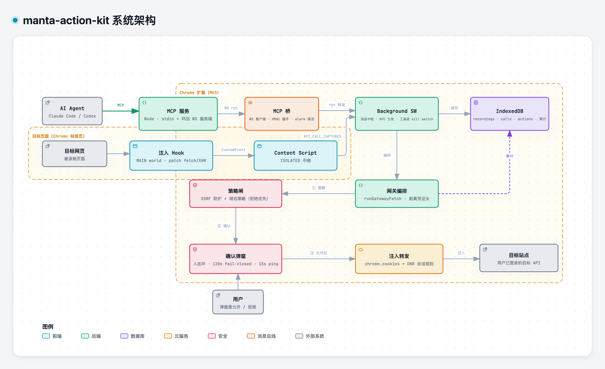

<div align="center">

# Manta Action Kit

**让 AI agent 安全访问你真实登录态下的 API——全程不交出任何凭证。**

[](https://chromewebstore.google.com/detail/manta-action-kit/pghddhbhbnlcehlmgnnalgaephllkeel)
[](LICENSE)
[](https://modelcontextprotocol.io)
[](PRIVACY.md)

[English](README.md) | **中文**

</div>

Claude Code、Codex、Cursor 写代码很强，但它们碰不了你**带鉴权**的业务 API——
要么把 Cookie / token 粘进 agent 配置（凭证泄进对话记录和日志），要么只能对
agent 说"这个你做不了"。

**Manta Action Kit** 解决这个问题：在浏览器里录制一次真实的 API 调用流程，
之后 agent 既可以重放它、也可以自由调用这些接口——而你的 Cookie 与 token
始终锁在浏览器里，**AI 连一个凭证都看不到**。

## 工作原理



1. **录制** —— popup 里点"开始"，正常操作页面，点"结束"。扩展捕获每一条
   `fetch`/`XHR`（请求**和**响应，含 SSE 流式响应），沉淀成可逐条查看的调用链。
2. **蒸馏** —— agent 经 MCP 读取录制，把它蒸馏成可复用、可参数化的
   **Action**（`{{param}}` 模板 + 步骤间 outputs 传递）。
3. **执行** —— `execute_action` 或 `proxy_fetch` 经沙箱网关重放流程。扩展在
   转发时注入你的会话 Cookie；AI 自始至终只发过 `method/url/headers/body`。

## 快速开始

**1. 安装扩展**：从
[Chrome Web Store](https://chromewebstore.google.com/detail/manta-action-kit/pghddhbhbnlcehlmgnnalgaephllkeel)
安装，然后登录你想让 agent 调用的那个网站——第 5 步要从那里录制。

**2. 复制安装提示词**：点击扩展工具栏图标，打开侧边栏（popup 里有「打开
侧边栏」入口）→ _Action_ 标签页 → _复制安装提示词_。里面嵌着你的专属桥接
token（`MANTA_TOKEN`）。工具栏看不到图标？Chrome 会把新装的扩展折叠进地址栏
旁的拼图菜单——点开它，把 Manta Action Kit 图钉固定即可。

**3. 把 MCP 服务加进你的 agent。** MCP 是 AI agent 接入外部工具的标准插口
——不用弄懂原理，照着做即可。需要 [Node.js](https://nodejs.org)（≥ 18，
用 `node -v` 自查；没装就去 nodejs.org 下 LTS 安装包）。安装提示词是
客户端无关的——直接粘给 Claude Code、Codex 或任意 MCP 客户端，agent 会把
服务注册进自己的配置；也可以手动加进 MCP 配置。想省事可以跑
`npx -y @manta-action-kit/mcp init`：自动检测本机已装的 agent 宿主
（Claude Code / Claude Desktop / Cursor / Windsurf / VS Code / Codex CLI），
勾选后自动写入各自的 MCP 配置，问到 token 时粘贴安装提示词即可，装完重启
对应 agent：

```json
{
  "mcpServers": {
    "manta-action-kit": {
      "command": "npx",
      "args": ["-y", "@manta-action-kit/mcp"],
      "env": {
        "MANTA_WS_PORT": "8787",
        "MANTA_PROXY_PORT": "8788",
        "MANTA_TOKEN": "<从扩展复制的 token>"
      }
    }
  }
}
```

`MANTA_TOKEN` 必须与扩展一致（它是桥接的认证密钥）；`MANTA_WS_PORT`
（默认 8787）需与扩展设置里的 MCP 端口一致；`MANTA_PROXY_PORT`（默认
8788）是沙箱代理的本地 HTTP 端口。保持默认值时这些变量都可以省略。详细
说明见 [`packages/mcp/README.md`](packages/mcp/README.md)，排障见
[`docs/claude-code.zh-CN.md`](docs/claude-code.zh-CN.md)。

> **想看 Claude Code 完整教程？** 见
> [`docs/claude-code.zh-CN.md`](docs/claude-code.zh-CN.md)。

> **用 WorkBuddy？** 它的 MCP 配置位于 `~/.workbuddy/mcp.json`，并且多一步
> —— 需要在连接器界面里「信任」该服务。见
> [`docs/workbuddy.zh-CN.md`](docs/workbuddy.zh-CN.md)。

> **用 JoyCode？** 它的 MCP 配置位于 `~/.joycode/joycode-mcp.json`（手动编辑，
> 保存后重启应用生效）。见 [`docs/joycode.zh-CN.md`](docs/joycode.zh-CN.md)。

> **用其他 MCP 客户端？** 任何能启动 stdio MCP 服务的客户端（Codex、Cursor、
> Claude Desktop 等）都能用上面的手动 JSON 配置——`command`/`args`/`env`
> 结构相同。Codex / Cursor / Claude Desktop 未逐一验证过，但安装提示词里
> 已包含它们所需的全部信息。

**4.（可选）安装 agent skill。** 一份随用随加载的打包使用指南——环境检查、
连接排障、工具用法——装上之后 agent 听到「检查环境」「连不上」「有哪些
action」这类话就能直接自查：

```bash
npx skills add marrviin/manta-action-kit -g -a claude-code -y   # 全局，Claude Code
```

去掉 `-g -a claude-code -y` 则进入交互式安装（可选任意支持的 agent 和
项目/全局作用域）。以后升级重跑同一条命令，或 `npx skills update -g`。
skill 是可选的——上面的 MCP 服务才是 agent 必需的。

**5. 用起来。** 在你的网站上录制一段流程，然后对 agent 说：

> _"我刚录了订单物流查询的流程。把它变成一个 action，然后查一下订单
> A1002 到哪了。"_

> **第一次录制提示**：点「开始」前先确认已登录（点「结束」时也还在登录态
> ——中途 session 过期会把一堆 401 录进调用链）；录制期间别在站内乱逛，
> 埋点和轮询请求会污染链路；跨多个站点的流程在执行时每个 host 会弹一次
> 确认框。

桥接 100% 跑在 `127.0.0.1` 上——除了你批准的 API 调用，没有任何数据离开
你的机器。

## 你的 agent 能拿到什么

录制是素材，**Action 才是产物**。蒸馏出的动作是可参数化、可重放的流程，
agent 像用其他工具一样列出并执行它们：

| 领域     | 工具                                                                                           |
| -------- | ---------------------------------------------------------------------------------------------- |
| 读取录制 | `list_recordings` · `get_recording` · `get_call` · `get_flow` · `get_endpoints`（脱敏 Schema） |
| Action   | `list_actions` · `search_actions` · `create_action` · `execute_action` 等                      |
| 沙箱代理 | `proxy_fetch` · `proxy_sse`（带你的登录态）                                                    |
| 运维     | `health` · 代理规则管理                                                                        |

> 完整工具表（30+ 个，含页面采集——元素捕获、截图、GIF——与代理规则管理）
> 见 [`packages/mcp/README.md`](packages/mcp/README.md)。
>
> **代理规则（proxy rule）**把一个脚本前缀映射到真实 base URL，让非 MCP
> 的脚本也能走同一条沙箱网关（同样的 Cookie 注入、同样的确认闸门）。
> 允许/拒绝域名名单只存在于扩展 UI——agent 没有任何工具能碰。

从 agent 视角看一个 Action 是这样的：

> `search_actions("track shipment")` → _track-order-shipment_ —— 参数
> `orderId`；步骤：查订单 → 把 `{{steps[0].outputs[id]}}` 传进物流接口 →
> `execute_action({ actionId, params: { orderId: "A1002" } })` → 搞定。全程
> 走你的登录态、一次确认弹窗、完整审计。

## 为什么它是安全的

凭证留在浏览器里、**永远到不了 AI**——这是整个产品的核心，而且在多层强制执行：

- **凭证在信任边界注入** —— 扩展经 `chrome.cookies` 读取 Cookie，在网络层
  注入请求头。Cookie 的**值**不出现在任何工具返回、对话记录或日志里。
- **人在环闸门** —— 每个新目标 host 都会弹出扩展侧确认窗口（展示
  method/URL/body）。录制的动作（`execute_action`）按 host 每次运行只需确认
  一次；直接调用（`proxy_fetch`/`proxy_sse`）默认逐请求确认。拒绝或无视，
  请求就发不出去。闸门默认开启（可在扩展沙箱设置里调整），**所有路径**
  （agent 调用与脚本驱动调用）都过这道闸，不依赖 MCP 客户端的行为。
- **SSRF 防护** —— loopback、私网、link-local、云元数据地址（含
  `169.254.169.254`）在任何其他策略**之前**直接拒绝，无一例外。
- **你说了算的域名策略** —— 拒绝域名直接拦、允许域名静默放行。agent **没有
  任何工具**能读取或修改这两张名单。
- **按工具 kill switch** —— 扩展设置里可单独关闭任意 MCP 工具。
- **审计日志** —— 每条转发调用都本地留痕；只记 Cookie **名称**，绝不记值。
- **双向认证的本地桥接** —— 环回 WebSocket 握手做双向 challenge-response
  （两侧各算 `HMAC(token, …)`；token 本身永不上线）。未认证连接直接断开，
  携带网页 Origin 连 `ws://127.0.0.1` 的直接拒绝，没配 token 服务端
  fail closed。
- **数据全部本地** —— IndexedDB + `chrome.storage`。无埋点、无外部服务器、
  无远程代码。见 [PRIVACY.md](PRIVACY.md)。

## 页面采集工具箱

除了 agent 流程，扩展还内置一套本地页面采集工具，集中在侧边栏的「页面采集」
标签页：**元素捕获**（框选任意元素 → 完整计算样式 JSON，支持 shadow DOM，
写入剪贴板）、**截图**（可见区域 / 整页）和 **GIF 录制**。所有数据不出本机
——`clipboardWrite`、`debugger`、`tabCapture`、`offscreen` 这几个权限就是为
它们准备的（见 [PRIVACY.md](PRIVACY.md)）。

## 本地开发

```bash
pnpm install          # 安装依赖 + wxt prepare
pnpm dev              # Chrome 开发模式（HMR，自动加载扩展）
pnpm build            # 生产构建 -> packages/extension/.output/chrome-mv3/
pnpm compile          # 整个工作区类型检查
pnpm test             # vitest 单测（安全关键的纯函数模块）
pnpm zip              # 打包成可上架 zip
```

本仓库是 pnpm monorepo：`packages/extension`（WXT + React 19 + Ant Design v6 +
Tailwind v4，Manifest V3）、`packages/mcp`
([`@manta-action-kit/mcp`](packages/mcp/README.md)，Node MCP 服务）、
`packages/protocol`（两侧共用的 WS 桥接协议与领域类型）和 `packages/skills`
（教 agent 使用整套工具箱的 skill）。架构与约定见
[CONTRIBUTING.md](CONTRIBUTING.md)——包括为什么 MV3 service worker 要**反方向**当
WebSocket 客户端、为什么 Cookie 注入走 `declarativeNetRequest` 而不是
`fetch credentials`。

## 许可证

MIT —— 见 [LICENSE](LICENSE)。
